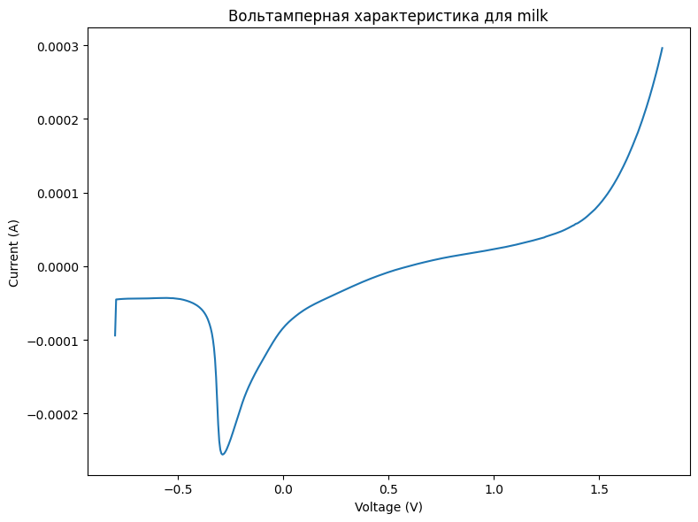

# Antibiotic screening in milk with voltammetry

An independent applied machine learning study of electrochemical measurements. **Can a current–voltage curve distinguish milk measurements associated with an antibiotic from milk controls?** I built a pipeline that turns instrument CSVs into a common feature table, compares five classifiers and exports diagnostic plots.

[Dataset and protocol](docs/README.md) · [Results and error analysis](reports/report.md) · [Command-line pipeline](main.py)

## Study at a glance

| Dataset | Model input | Main task |
| :--- | :--- | :--- |
| **1,377** voltammograms, including **270** milk controls | **521** current readings indexed by voltage | Binary classification across **five** antibiotic categories and milk controls |

The signal enters the model as a sampled current–voltage curve. Antibiotic identity supplies the label. The recorded concentration is kept in the data table and excluded from the feature matrix. [Data loader](src/data/load_data.py) · [Binary task](main.py#L69-L85)



*An example milk-control voltammogram from the exploratory analysis. The model receives the sampled current values.*

## What the experiment found

On the recorded stratified row-level split, **Random Forest reached 0.973 positive-class F1** and flagged **219 of 222** antibiotic-group measurements. It also flagged **9 of 54** milk controls. Gradient boosting and k-nearest neighbors achieved nearly the same F1. [Full comparison and confusion matrix](reports/report.md)

The evaluation is exploratory. The dataset contains several concentrations per antibiotic, and the processed table lacks batch or sample identifiers. Related measurements could therefore share a train/test split. The current script also ranks models on that same split. Performance on new batches remains an open question. [Evaluation design and follow-up test](docs/README.md#evaluation-protocol)

## Run the analysis

From the repository root, install the Python dependencies in an isolated environment and use the included processed CSV to run the binary comparison.

```bash
python -m pip install numpy pandas scikit-learn matplotlib termcolor tabulate
python main.py train_binary
```

The command writes the metrics table and diagnostic figures under `reports/`. The repository also includes raw-data collection, signal visualization and a multiclass entry point. [Inputs, commands and output files](docs/README.md#running-from-the-repository-root)
