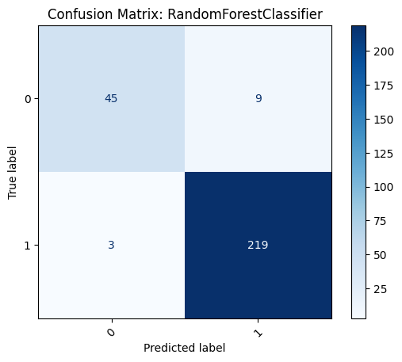

# Результаты бинарной классификации

[Обзор исследования](../README.md) · [Данные и протокол](../docs/README.md)

## Сравнение моделей

В таблице приведены метрики из сохранённого CSV. Полнота и F1 рассчитаны по положительному классу, в который входят пять категорий антибиотиков.

| Модель | Доля верных ответов | Полнота | F1 |
| :--- | ---: | ---: | ---: |
| Случайный лес | 0,9565 | **0,9865** | **0,9733** |
| Градиентный бустинг | 0,9565 | 0,9820 | 0,9732 |
| Метод ближайших соседей | 0,9565 | 0,9730 | 0,9730 |
| SVM | 0,9420 | 0,9820 | 0,9646 |
| Логистическая регрессия | 0,9058 | 0,9730 | 0,9432 |

У трёх лучших моделей одинаковая доля правильных ответов. Их F1 на этом разбиении различается максимум на 0,0003. В тесте 222 положительных измерения из 276. Правило «всегда предсказывать положительный класс» дало бы F1 = 0,892 и ошибочно пометило бы все 54 контрольных измерения. [Сохранённый CSV с метриками](model_results.csv)

## Разбор ошибок случайного леса

*Строки соответствуют фактическим классам, столбцы — предсказаниям. Класс 0 — контрольное молоко, класс 1 объединяет пять категорий антибиотиков.*

Модель обнаружила 219 из 222 положительных измерений (полнота 98,6 %) и правильно распознала 45 из 54 контрольных (специфичность 83,3 %). При использованном пороге получилось три пропуска и девять ложных срабатываний.

[Сохранённая ROC-кривая](figures/roc_binary_Random_Forest.png)

## Интерпретация

Вольтамперограммы содержат сигнал, по которому модель различает два класса в этом наборе. Перед применением для скрининга нужно измерить частоту пропусков и ложных срабатываний на независимо собранных образцах и проверить, как она меняется с концентрацией. Определение предела обнаружения и проверка порога для практической работы требуют отдельной оценки.
